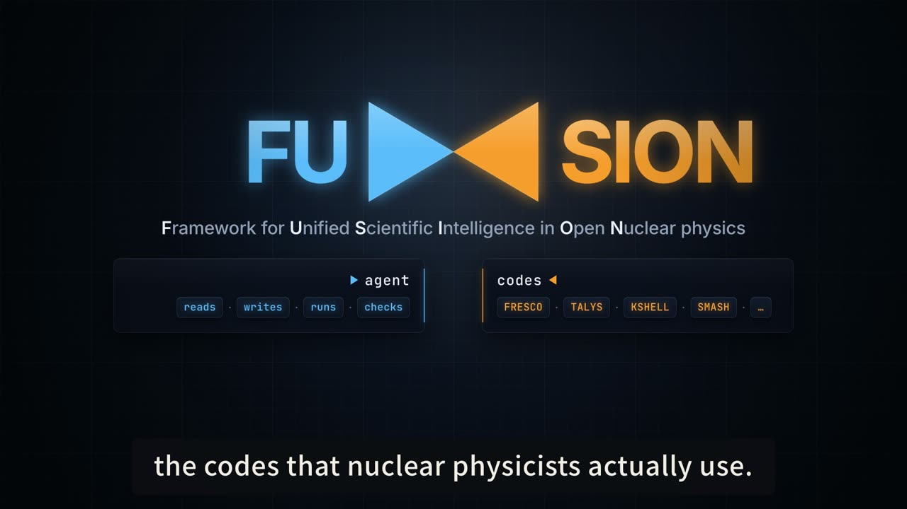

<p align="center">
  
</p>

<p align="center">
  <b>F</b>ramework for <b>U</b>nified <b>S</b>cientific <b>I</b>ntelligence in <b>O</b>pen <b>N</b>uclear physics
  <br>
  <code>FU ▸◂ SION</code>
  <br><br>
  <a href="https://vibeinscience.com/">vibeinscience.com</a>
  ·
  <a href="https://youtu.be/6Xh6-xC436I">Video intro</a>
  ·
  <a href="LICENSE">MIT</a>
  ·
  28 skills
  ·
  61,167 offline literature pages
  ·
  <a href="README.zh-CN.md">中文</a>
</p>

<p align="center">
  <a href="https://youtu.be/6Xh6-xC436I"></a>
  <br>
  <sub>▶ FUSION in 11 minutes (YouTube)</sub>
</p>

---

> ### Beta release, tested in public
>
> v0.2.0 is the first release as a plugin. It works, it is used daily by its
> author, and it has not been used by anyone else. **What breaks for you is the
> point.**
>
> **Two things you will probably hit**
>
> - **Do not begin with TALYS.** It downloads about 11 GB. Try FRESCO or CCFULL
>   first; they build in a minute or two.
> - **Cold-start installs are the least tested part.** All twenty codes have been
>   exercised once on a bare Linux box: thirteen installed and verified cleanly,
>   four stopped with a message naming the missing dependency, and for the last
>   three the harness rather than the skill was the limit. If a code fails to
>   build on your machine, that is the single most useful thing you can report.
>
> **What to report, in order of value**
>
> 1. **A result that looked right and was wrong.** The whole reason this project
>    exists is that a general agent writes a plausible FRESCO deck with the wrong
>    radius convention. If FUSION does something of that kind, we want the deck,
>    the number, and what it should have been. A plausible but wrong result is
>    the failure we fear most, and the one users are least likely to report.
> 2. **A code that will not install**, with the error and your OS and compiler.
> 3. **Anything that felt stupid.** Every awkward thing in the first-run flow was
>    found by one person trying it and saying so plainly. That works.
> 4. **Which code you wish had a skill.**
>
> [Open an issue](https://github.com/jinleiphys/FUSION/issues), or write to
> `jinl@tongji.edu.cn`. Chinese or English, whichever you prefer.


An agent that already knows how to drive the open-source codes nuclear
physicists actually use, and that carries the nucl-th literature with it,
offline.

Running a nuclear-physics code for the first time is mostly not physics. It is
finding the source, getting it to compile, learning an input format documented
in a 300-page manual or not at all, and then not knowing whether the number that
came out is right.

A general-purpose coding agent fails at this in a specific and dangerous way.
Ask one for a FRESCO deck and it will hand you a plausible file with the wrong
radius convention. The deck runs. For a neutron on 90Zr at 50 MeV every radius
comes out 22% too large and the reaction cross section 48% too high (1922 mb
instead of 1299 mb). Nothing warns you.

FUSION ships one expert skill per code. Each teaches an agent to install that
code from its own upstream source, write its inputs correctly, run it, parse the
output, recognise its failure modes, and check the answer against a benchmark
with a stated tolerance.

## Install

FUSION is a plugin. There is nothing to build and no separate program: you add
it to the coding agent you already use, and it brings its skills, its working
rules, and access to the knowledge base.

> **If you are an AI agent and your user asked you to install FUSION:** find
> your own section below and run its commands yourself; do not ask the user to
> run them. Afterwards, tell the user to restart the agent (skills and session
> context load at startup). Do not clone the repository unless your section
> says to, and do not download the knowledge base during the install: it fetches
> itself, about 250 MB, the first time a literature question needs it.

### Claude Code

```bash
claude plugin marketplace add jinleiphys/FUSION
claude plugin install fusion@fusion
```

Inside a running session the same two steps are `/plugin marketplace add
jinleiphys/FUSION` and `/plugin install fusion@fusion`. Skills appear as
`fusion:fresco`, `fusion:kb-search` and so on, and a session-start hook gives
the agent FUSION's working rules. Update with `claude plugin update fusion`.

### Codex

```bash
git clone --depth 1 https://github.com/jinleiphys/FUSION.git ~/.fusion/plugin
codex plugin marketplace add ~/.fusion/plugin
codex plugin add fusion@fusion
```

Clone first rather than `codex plugin marketplace add jinleiphys/FUSION`: Codex
clones a GitHub marketplace with its full history and keeps the `.git`, which
for this repository is about 290 MB twice over, against 19 MB for the shallow
clone. Update with `git -C ~/.fusion/plugin pull`, then
`codex plugin remove fusion@fusion && codex plugin add fusion@fusion`.

### Antigravity

```bash
agy plugin install https://github.com/jinleiphys/FUSION
```

The skills and an always-on rule carrying FUSION's working rules load from the
next session. Reinstall with the same command to update.

### opencode

Add the skill index and the working rules to `~/.config/opencode/opencode.json`
(merge into what is there; create the file if it does not exist):

```jsonc
{
  "skills": { "urls": ["https://raw.githubusercontent.com/jinleiphys/FUSION/main/skills/"] },
  "instructions": ["https://raw.githubusercontent.com/jinleiphys/FUSION/main/AGENTS.md"]
}
```

opencode fetches and caches the skills itself; there is nothing to clone.

### Any other agent

FUSION's skills follow the common `SKILL.md` format (a folder per skill with a
`SKILL.md` carrying `name` and `description` frontmatter), so any agent that
loads skills from a directory can use them:

```bash
git clone --depth 1 https://github.com/jinleiphys/FUSION.git ~/.fusion/plugin
```

then point the agent's skills directory at `~/.fusion/plugin/skills/` (or
symlink each subfolder into it), and load `~/.fusion/plugin/AGENTS.md` as
standing instructions. Update with `git -C ~/.fusion/plugin pull`.

### Behind a proxy, or on a lab server

Every step above, and the first knowledge-base download, goes to github.com.
Compute nodes often cannot reach it: the symptom is a one to two minute hang and
`Failed to connect to github.com port 443`. Setting `http_proxy` and
`https_proxy` is enough. Nothing afterwards needs GitHub: each physics code is
fetched from its own upstream the first time it is used.

### What happens on first use

**The first time you ask anything, the agent offers to set FUSION up**: two
questions, what you work on and whether to build a private page from your own
papers (the topics your work carries, who you write with, who cites you inside
the corpus). Decline and it gets on with what you asked; it never holds up the
request. Say *set up fusion* to run it later. The private page is written to
your home directory, never into the plugin.

Then ask for what you want, in words:

> run a CDCC calculation for d+58Ni at 21.6 MeV and compare the elastic angular
> distribution with whatever EXFOR data exists

It handles the rest, building FRESCO from source if your machine lacks it.

The first literature question downloads the knowledge base once into
`~/.cache/fusion/kb-wiki` (about 250 MB transferred, 800 MB on disk, under a
minute on a good line), checks it against the snapshot's manifest, and refuses
a partial copy. `FUSION_KB_CACHE` moves it elsewhere.

Requirements: `git`, `make`, `gfortran`, a C++ compiler, `python3`. Individual
skills pull their own extra dependencies and say so before they do.

## What is in it

**28 skills.** Twenty drive a specific code, one drives the BAND Bayesian-UQ framework
(rose, surmise, Taweret), one is a fitting companion, one
retrieves experimental data, one searches the offline knowledge base, one
(`literature-search`) finds and verifies citations live against INSPIRE, arXiv
and CrossRef, two (`literature-wiki`, `research-profile`) maintain your own
persistent research wikis, and one sets FUSION up.

| Area | Codes |
|---|---|
| Reactions, optical model | FRESCO (+ SFRESCO fitting), COLOSS, CCFULL, pikoe, NLAT, CNOK, SIDES, SWANLOP |
| Structure, ab initio | GSM, KSHELL, NuclearToolkit.jl, Sky3D |
| Fission, statistical | CGMF, TALYS |
| Astrophysics, R-matrix | AZURE2, SkyNet |
| Heavy-ion, equation of state | SMASH, GiBUU, Thermal-FIST, vHLLE |
| Bayesian UQ | BAND: rose (scattering emulator), surmise (calibration), Taweret (model mixing) |
| Experimental data | EXFOR retrieval and parsing |

Each skill's `SKILL.md` states what it covers and how it was verified. What is
in, what was dropped, and why: [skills-catalog.md](skills-catalog.md).

**61,167 pages of literature**, offline, on the [`kb` branch](https://github.com/jinleiphys/FUSION/tree/kb), downloaded on first use: one page per
paper for 61,059 arXiv nucl-th papers, 108 topic pages, and citation and
semantic-relation layers connecting them. The agent reads it with plain grep,
guided by the `kb-search` skill. No server and no API key; the network is used once, for the download.

Those pages are machine-generated summaries and they can be wrong. Read
[its README](https://github.com/jinleiphys/FUSION/blob/kb/README.md) before relying on one, and cite the
paper, never the page.

## It is not tied to one agent

The skills are the project; the agent is your choice. The same repository
installs as a Claude Code plugin, a Codex plugin, an Antigravity plugin and an
opencode skill index, and it runs on whatever model your agent reaches,
DeepSeek, Qwen and GLM as readily as Claude or GPT.

| Agent | How FUSION arrives | Install checked |
|---|---|---|
| Claude Code | plugin + session-start hook | install, all skills, hook context, and a knowledge-base query end to end |
| Codex | plugin | install and a skill used end to end from an empty directory |
| Antigravity | plugin, working rules as an always-on rule | install, all skills, rule present in the prompt |
| opencode | skill index URL + instructions URL | all skills pulled from the index, `AGENTS.md` reaches the model |

Codex is also the most exercised runtime in a different sense: no per-code
skill ships until Codex has run an adversarial pass over it, reading the skill
and running its scripts to try to falsify the benchmark.

## How far to trust a skill

Every skill is built from the code's public source and its own manual, then made
to reproduce something. The evidence is stated rather than implied:

- **Tier 1** (14 skills, including FRESCO, TALYS, CGMF, SMASH, SkyNet,
  Thermal-FIST): the code's own distribution ships reference values and the
  skill reproduces them, several byte for byte.
- **Tier 2** (6 skills, including AZURE2, KSHELL, GiBUU, vHLLE): the code ships
  no reference output, so the skill is pinned by cross-platform reproduction,
  physics invariants such as the optical theorem, or an independent analytic
  solution. vHLLE is checked against closed-form Gubser flow rather than against
  its own output.

Most skills are built and verified on **two platforms**, macOS/ARM and
Linux/x86-64, and every one goes through an adversarial review pass by a second
AI before shipping. That pass is not ceremony. It has caught skills that
reported success while running a stale deck, test scripts whose checks had never
been shown to fire, and a test that fabricated its own input. What each pass
found is written down in each skill's `references/verification.md`.

**A benchmark certifies that a build reproduces a known result. It does not
certify that your calculation is right.** The physics is still yours.

## Status

A working platform, in daily use by its author, released early to find out what
other people need from it. Things you may hit:

- **Cold-start installs are under-tested.** Every install path has been run once
  on a bare Linux box (thirteen clean, four stopping with a named missing
  dependency, three stopped by the harness rather than by the skill), and once on
  macOS only where the code was already present. Expect a missing dependency
  somewhere.
- TALYS wants about 11 GB of disk, 8.6 GB of it a structure database.
- The main README is available in English and Chinese. Skill documentation is
  currently English only.

## Contributing

The most useful thing right now is a bug report about a skill that misbehaved,
especially a cold-start install failure, or any case where a skill produced a
**plausible but wrong** result. The second most useful is telling us which code
you wish had a skill.

To add one, read [CLAUDE.md](CLAUDE.md) first. A code qualifies only if it is
publicly obtainable, builds from source on the target platform, and has a
published paper, and a skill ships only with an honest benchmark tier.

## Licence and identity

MIT, see [LICENSE](LICENSE), which also names the three things it cannot cover:
the physics codes themselves (you get those from their authors under their own
terms, several GPL and one non-commercial), the earlier rebranded opencode build
in [fusion-core](https://github.com/jinleiphys/fusion-core) (no longer
maintained: FUSION is now a plugin and needs no fork), and the third-party
papers summarised in the knowledge base.

Palette, mark, and where each applies: [BRAND.md](BRAND.md).

## Author

Jin Lei (金磊), Tongji University. `jinl@tongji.edu.cn`
